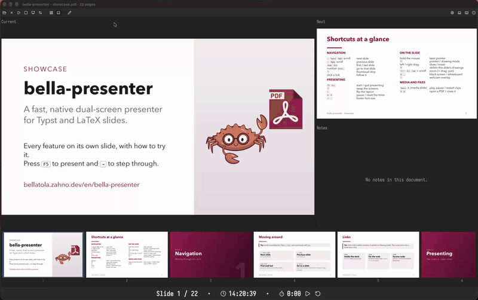
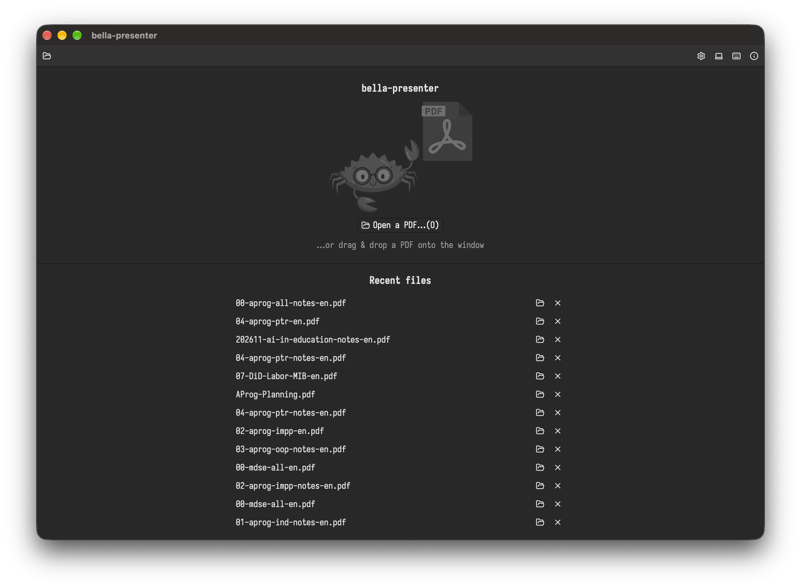
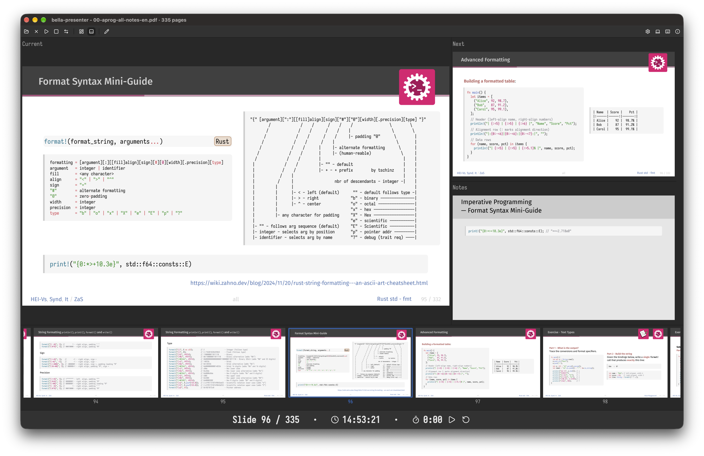
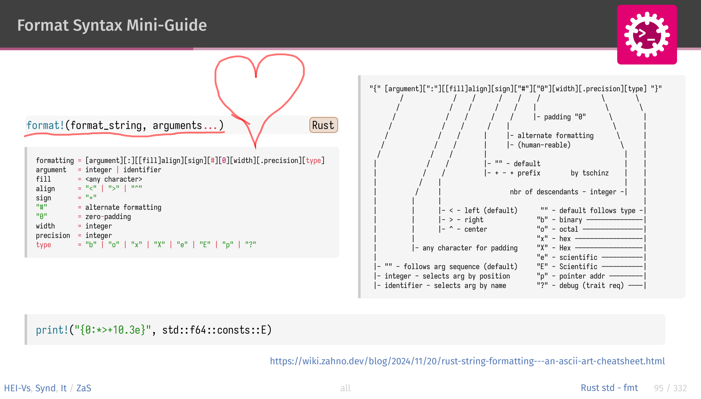
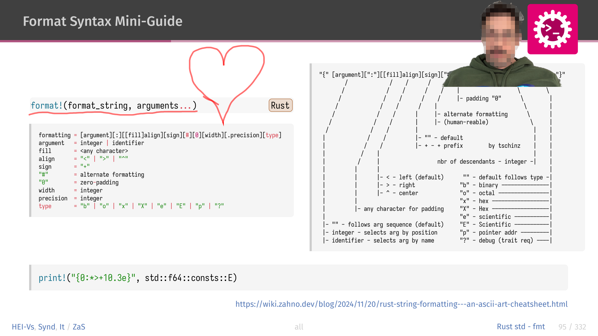
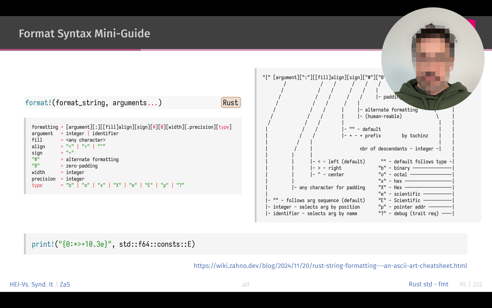
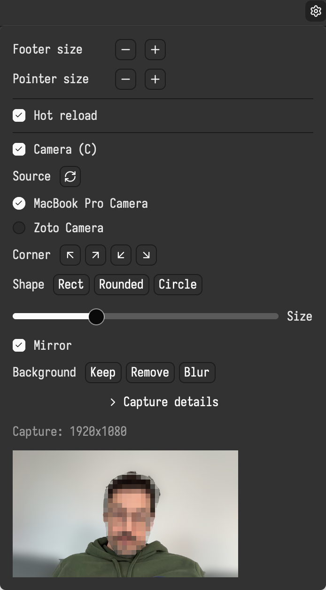
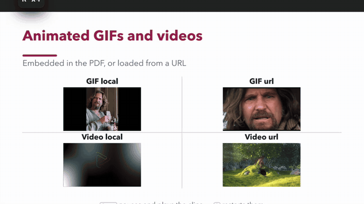

<div align="center">


# bella-presenter

**A fast, native dual-screen PDF presenter for Typst & LaTeX slides.**

Runs on macOS · Windows · Linux · Built with [GPUI](https://gpui-kit.com) + [PDFium](https://pdfium.googlesource.com/pdfium/)

[](https://github.com/tschinz/bella-presenter/stargazers) [](https://github.com/tschinz/bella-presenter/releases/latest) [](https://github.com/sponsors/tschinz)

</div>

---

## What it does

Open a PDF exported from **Typst** or **LaTeX/Beamer** and drive a talk with two windows:

- 🖥️ **Presenter window** - the current slide, a next-slide preview, your speaker notes, a talk timer, and a thumbnail strip of all slides.
- 📽️ **Audience window** - just the slide, on black, fullscreen on the projector.

It stays instant even on large decks (300+ pages) thanks to lazy rendering, a texture cache, and next-slide prefetch.

## Screenshots

**In action** - a walk through the [showcase deck](examples/showcase.pdf): presenter view, links, speaker notes, drawing, black screen, whiteboard, webcam and media.



**Start screen** - launch with no file to pick from your recent decks, or just drag & drop a PDF onto the window.



**Presenter window** - current slide, next-slide preview, speaker notes, a centered slide counter / clock / timer, and the slide thumbnail strip.



**Live annotation** - hold the mouse over the current slide to draw freehand (mirrored on the audience screen); press `P` to switch between the laser pointer and drawing, and `D` to clear.



**Audience webcam overlay** - show the presenter in a configurable corner of the projected slide, here with the background removed and a freehand drawing on the slide.



The overlay can also be a circle, keeping the camera's background.



**Camera settings** - choose the camera, position, size and shape; set the background to normal, blurred or removed.



## Install

Grab a prebuilt binary from the [latest release](https://github.com/tschinz/bella-presenter/releases/latest) — PDFium is bundled, so there is nothing else to install:

| Platform | Asset | Notes |
| --- | --- | --- |
| macOS (Apple Silicon) | `bella-presenter-macos-arm64.zip` | ad-hoc-signed `.app`; open via right-click → **Open** the first time |
| Linux (Debian/Ubuntu) | `bella-presenter_<ver>_amd64.deb` | `sudo dpkg -i` the file |
| Windows (x64) | `bella-presenter-windows-x64.zip` | portable (`bella-presenter.exe` + `pdfium.dll`) |

Intel Macs and other Linux distros are not prebuilt — [build from source](#build-from-source).

### One-line install

**macOS & Linux** — installs the `.app` into `/Applications` (clearing quarantine) or the `.deb` via `dpkg`:

```bash
curl -fsSL https://raw.githubusercontent.com/tschinz/bella-presenter/main/install.sh | bash
```

**Windows** (PowerShell) — extracts the portable build to `%LOCALAPPDATA%\Programs\bella-presenter` and adds a Start Menu shortcut:

```powershell
irm https://raw.githubusercontent.com/tschinz/bella-presenter/main/install.ps1 | iex
```

## Features

- **Works with or without notes.** Auto-detects Beamer/Typst "notes on second screen" decks (a double-width page whose right half is the notes) and splits them; plain decks just work.
- **Two windows, second-screen aware.** `F5` opens the audience window — on a second screen it goes fullscreen there automatically; on a single screen it goes fullscreen over the presenter (all shortcuts still work). `Esc` quits it while the presenter keeps running.
- **Thumbnail strip.** A scrollable, resizable filmstrip of every slide; click to jump, and it follows the current slide. Toggle with `T`.
- **Adaptive, resizable layout.** Cycle 4 current/next/notes arrangements (or a H/V current+next split without notes) with `L`; drag any divider to resize. Sizes are remembered.
- **Laser pointer & drawing, mirrored.** Hold the mouse on the current slide for a pointer dot, or press `P` to draw freehand — shown live on the audience screen. Pick the colour from a swatch in the header.
- **Zoom & pan.** `⌥`/`⌘`/`Ctrl` + scroll zooms at the cursor, the same keys + drag pan — on either window, mirrored to the room. Zooming grows the slide into the letterbox bars, so a portrait page fills the window width.
- **Webcam overlay.** Show your camera in a configurable corner of the audience window only (`C`). Choose a rectangle, rounded rectangle or circle, and set the size, source and mirroring from the ⚙ popover, which also shows a live preview and capture resolution. The camera runs only while presenting or while the settings popover is open.
- **Background options.** Keep the normal background, blur it, or remove it to show only the person. See the screenshots above. Removal uses a small built-in segmentation model (about 0.5 MB) and runs locally on the CPU; no images are uploaded.
- **Talk timer + clock, light/dark theme.** Large centered footer with slide number, wall clock, and a stopwatch that follows the presentation; pause, resume and reset it with `K` / `R` or the buttons next to it. Cycle system/dark/light theme from the header.
- **Go to a slide.** Type its number and press `Enter`; the footer shows what you typed.
- **GIFs and videos on slides.** Decks made with [`bella-media.typ`](bella-media.typ) carry their GIF and MP4 clips inside the PDF (or load them from a URL); bella-presenter plays them, with sound, exactly over the static placeholder that other PDF viewers show. See [Media in slides](#media-in-slides).
- **Clickable links.** Links in the PDF work on either window: a click on a link to another slide jumps there, web and mail links open in the browser or mail app. The cursor turns into a hand over a link.
- **Recent files + resume.** Launch with no file to pick a recent deck; reopening resumes at the page you left off.
- **Open with.** Installed builds appear in the OS "Open with" menu for PDFs (macOS, Linux `.deb`, Windows via `install.ps1`); the file opens directly, also into a running instance.
- **Updates.** At start the app checks the latest GitHub release and offers to install it and restart (macOS replaces the `.app`, Linux installs the `.deb` via `pkexec`, Windows replaces the portable files). Never shown while presenting.
- **Remembers everything.** Window position, panel sizes, fonts, layout, theme, pointer colour, thumbnail strip, and recent files persist between sessions, in a single JSON file (`~/.config/bella-presenter/state.json` on macOS/Linux, `%APPDATA%\bella-presenter\state.json` on Windows).

## Keyboard & mouse shortcuts

| Input | Action |
| --- | --- |
| `→` / `Space` / `PageDown` / scroll down | Next slide |
| `Space` (slide with media) | Play the slide's waiting GIFs and videos, or pause them once all play |
| `R` (slide with media) | Restart the slide's GIFs and videos |
| `←` / `PageUp` / scroll up | Previous slide |
| `Home` / `End` | First / last slide |
| `F5` / `Esc` | Start / quit presentation |
| `B` | Blank the audience screen (black) |
| `,` | Whiteboard: a white page to draw on, on both screens (again to leave) |
| `W` | Close the file, back to the start screen |
| `R` | Reset the talk timer (on a slide with media: restart its clips; the footer button always resets) |
| `K` | Pause / resume the talk timer (also a button in the footer) |
| Number + `Enter` | Go to that slide (`Esc` cancels) |
| `L` | Flip layout |
| `T` | Toggle the thumbnail strip |
| `S` | Swap presenter / presentation screens |
| `+` / `−` | Footer font larger / smaller |
| `O` | Open a PDF |
| `C` | Toggle the webcam overlay (settings in the ⚙ popover) |
| `P` / `D` | Toggle laser pointer / drawing · delete the drawings on this slide |
| Left-drag (drawing mode) | Draw on the slide |
| Right-drag (drawing mode) | Erase part of a drawing (a light red circle shows the eraser) |
| Hold mouse on current slide (either window) | Laser pointer / draw (shown on the audience screen) |
| Click a link (pointer or drawing mode) | Follow it: jump to the slide, or open a web or mail link |
| `Ctrl`, `Alt`/`⌥` or `⌘` + scroll / drag (either window) | Zoom at the cursor / pan the zoomed slide |
| Double-click (audience) | Toggle fullscreen |
| Drag & drop a PDF | Open it |

All mouse features work on **either window** and drive the same shared state, so the pointer, drawings, and zoom always mirror between the presenter and audience screens. The **Shortcuts** button in the header shows this list in-app.

## Media in slides



Animated GIFs and MP4 videos play right on your Typst slides. They live inside the PDF, or come from a URL, so there are no extra files to carry around. Any other PDF viewer shows a still placeholder in their place.

**1. Get the template.** Copy [`bella-media.typ`](bella-media.typ) into the root folder of your Typst project and import it:

```typst
#import "/bella-media.typ": media, media-url
```

**2. Add media.** Each call reserves a box of the given size; the clip is letterboxed inside it.

A local GIF (other viewers show its first frame):

```typst
#media("clips/demo.gif", width: 12cm, height: 6.75cm)
```

A local MP4 with a poster image (other viewers show the poster):

```typst
#media("clips/demo.mp4", width: 12cm, height: 6.75cm, poster: "clips/demo-poster.png")
```

Clips start by themselves when their slide shows. To keep a video on its poster until you press `Space`:

```typst
#media("clips/demo.mp4", width: 12cm, height: 6.75cm, poster: "clips/demo-poster.png", autoplay: false)
```

The same video without its sound (videos play their sound by default):

```typst
#media("clips/demo.mp4", width: 12cm, height: 6.75cm, poster: "clips/demo-poster.png", muted: true)
```

A GIF from a URL:

```typst
#media-url("https://media.giphy.com/media/yk8tRCZHCV0qY/giphy.gif", width: 8cm, height: 6cm)
```

An MP4 from a URL, with any content as the poster (posters are transparent, so give it its own background if it needs one):

```typst
#media-url(
  "https://example.org/talk/demo.mp4",
  width: 12cm,
  height: 6.75cm,
  poster: block(width: 100%, height: 100%, fill: black, align(center + horizon, text(fill: white)[Demo video])),
)
```

**3. Compile** from the project root, so the template can read your files:

```bash
typst compile --root . slides.typ
```

Open the PDF in bella-presenter: the clips play when their slide comes up.

| Option | Default | Meaning |
| --- | --- | --- |
| `width`, `height` | `100%` | Size of the box on the slide |
| `poster` | `none` | What other viewers show: an image path, image bytes or any content, drawn as it is (a transparent SVG or PNG keeps the slide behind it). `none` shows a local GIF's first frame (as it is, without a box), or a black block for a video or a web GIF |
| `autoplay` | `true` | `false` shows the placeholder (first frame, poster or black) and waits for `Space` |
| `loop` | `true` | `false` stops on the last frame |
| `muted` | `false` | `true` silences the video's sound (videos play their AAC sound through the default output) |
| `fit` | `"contain"` | `"contain"` letterboxes the clip (and an image poster) in its box; `"cover"` fills the box and cuts off what overflows, like CSS `object-fit`. Older bella-presenter versions letterbox either way |
| `mime` | `auto` | Taken from the file extension; set `"image/gif"` or `"video/mp4"` for a URL without one |
| `name` | `auto` | The file name inside the PDF; needed when you pass bytes instead of a path |

Good to know:

- **Paths** are relative to the folder holding `bella-media.typ`, or start with `/` (the project root with `--root .`). To use a path relative to your own file, pass the bytes: `#media(read("demo.gif", encoding: none), name: "demo.gif", width: 8cm, height: 6cm)`.
- **Formats:** GIF and H.264 MP4 (Baseline, Main, High). WebM and other codecs keep their placeholder, with a note in the footer. A video plays its AAC sound unless you set `muted: true`; the sound sets the pace, so picture and sound stay together. Convert a screen recording or another video with (replace `-c:a aac` by `-an` to drop the sound):

  ```bash
  ffmpeg -i recording.mov -c:v libx264 -crf 23 -pix_fmt yuv420p -c:a aac -movflags +faststart demo.mp4
  ```

- **URLs** must point at the file itself over HTTPS. A Giphy page has a direct link (`media.giphy.com/media/<id>/giphy.gif`); YouTube serves no video file and cannot be used. Web media loads when its slide is next or current and is kept for the session; offline, the placeholder stays and the footer shows a note.
- **Playback:** clips play on the current slide in the presenter and audience windows, letterboxed like CSS `object-fit: contain` (or filling their box with `fit: "cover"`), and follow zoom. The next-slide preview and thumbnails show the placeholder. Clips start by themselves unless `autoplay: false`. `Space` plays the clips of the current slide that wait, and pauses them all once all play; `R` starts them over. The black screen (`B`) and the whiteboard (`,`) pause the clips of the slide; leaving the slide stops them, and they start over when you come back.
- **Builds:** a step that hides a clip (touying's `#pause`, Typst's `hide`) does not play it; the clip plays from the step where it appears.

[`examples/showcase.typ`](examples/showcase.typ) uses all of this; its PDF shows every feature of the app.

## Webcam

Enable it with `C` or from the ⚙ popover in the header. The overlay appears on the audience window only (hidden while the screen is blanked with `B`).

- **Source:** all cameras the OS reports are listed; use ⟳ to rescan. The app picks the best mode of at least 720p at about 30 fps, and the popover shows the resolution actually received. **Capture details** lists the modes the camera offers, useful when a camera delivers less than expected.
- **Layout:** corner, size, shape and mirror are saved with your other settings.
- **Shape:** rectangle, rounded rectangle or circle.
- **Background:** *Keep* (normal image), *Blur* (person stays sharp) or *Remove* (transparent background, showing only the person). Removal ignores the shape setting. Quality improves with a sharper camera image.
- **Permissions:** on macOS the first start asks for camera access. When running with `just run` from a terminal, that terminal app needs camera access in System Settings > Privacy & Security > Camera. The bundled `.app` carries its own usage description.

## Build from source

Rendering needs Google's PDFium (loaded at runtime). Fetch the prebuilt library for your platform once, then run:

```bash
just setup-pdfium        # downloads PDFium into third_party/pdfium/ (git-ignored)
just run                 # open the showcase deck (every feature)
just run file=deck.pdf   # open your own PDF
```

Without `just`: `cargo run --release -- examples/showcase.pdf` (PDFium must be reachable — next to the binary, in `third_party/pdfium/lib/`, or via `$PDFIUM_LIB_DIR`).

## Packaging

Releases are built by CI on a `v*` tag: a macOS `.app` (zipped, ad-hoc signed), a Linux `.deb`, and a Windows portable zip. To build a self-contained bundle yourself (icon + PDFium included) with [cargo-bundle](https://github.com/burtonageo/cargo-bundle):

```bash
just bundle        # bundle for the current OS
```

Per-format recipes (run each **on its target OS** — cargo-bundle does not cross-build): `just bundle-mac` (`.app`), `just bundle-deb` (`.deb`), `just bundle-appimage` (`.AppImage`, Linux-only, not shipped in releases), `just bundle-msi` (`.msi`, Windows, needs WiX). `just bundle-mac` ad-hoc signs the `.app` so it isn't reported as "damaged" locally.

## Development

```bash
just            # list all recipes
just test       # run tests (headless; need PDFium present)
just clippy     # lint
just build      # release build into bin/
```

The **About** window lists every third-party library with its license, generated from the dependency tree with [cargo-about](https://github.com/EmbarkStudios/cargo-about) and embedded into the app; regenerate with `just thirdparty` after changing dependencies.

## License

Licensed under the [MIT license](LICENSE). PDF rendering uses Google's PDFium (BSD-3-Clause), bundled with the application. Background removal uses the MediaPipe selfie segmentation model (Apache-2.0, ONNX conversion by onnx-community) with ONNX Runtime; full license texts are in the app's **About** window and in `assets/thirdparty.md`.

The logo is built from one of the Ferris illustrations in the [free-ferris-pack](https://github.com/MariaLetta/free-ferris-pack) by Maria Letta (CC0-1.0).
